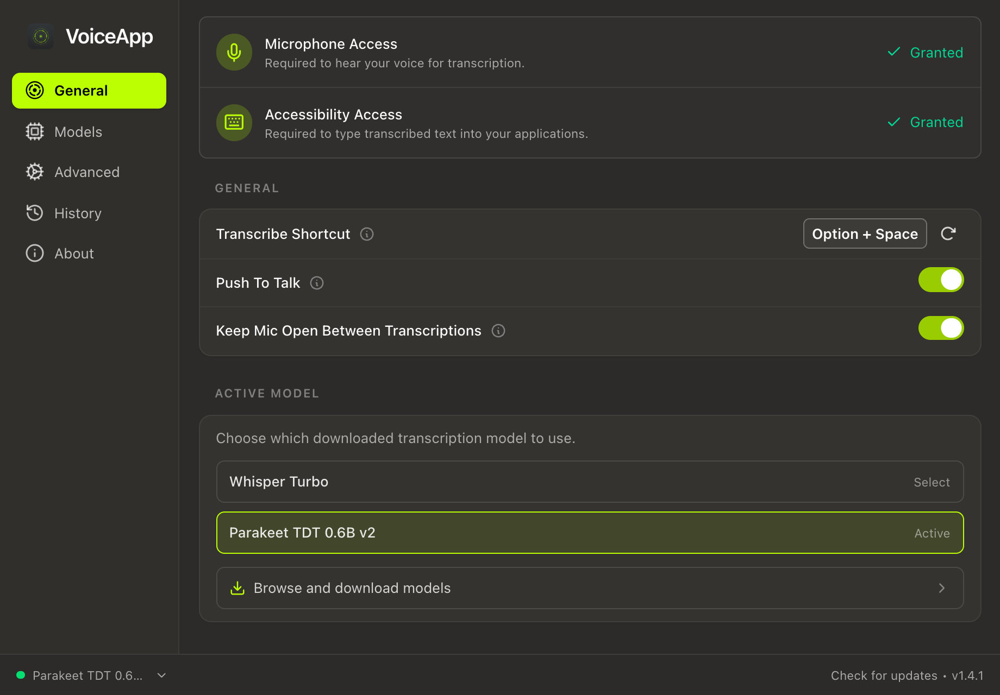

<div align="center">


# VoiceApp

**Free, open-source dictation for Mac.**<br />
Hold a shortcut, speak, and release to type your words into the app you’re using.

<p>
  <a href="https://github.com/DistinctZA/voiceapp-releases/releases/latest"></a>
  <a href="LICENSE"></a>
  
  
</p>

<p>
  <a href="https://github.com/DistinctZA/voiceapp-releases/releases/latest"><b>Download for Mac</b></a> ·
  <a href="https://voice-app.xyz/">Website</a> ·
  <a href="#features">Features</a> ·
  <a href="#build-from-source">Build from source</a>
</p>



</div>

VoiceApp lives in the menu bar. With a local model, dictation works offline and your audio stays on your Mac. You can also choose a cloud provider and use your own API key.

## Download

**macOS · Apple silicon (M1 or later)**

1. Download the `.dmg` from the [latest Mac release](https://github.com/DistinctZA/voiceapp-releases/releases/latest), open it, and drag **VoiceApp** into **Applications**.
2. Open VoiceApp and grant **Microphone** access to record and **Accessibility** access to type into other apps.
3. Choose a model. Try **Parakeet TDT 0.6B v2** for English or **Whisper** for multilingual dictation.
4. Place your cursor in a text field, hold **Option + Space**, speak, and release. You can change the shortcut in **General**.

Check for updates in the menu bar or at the bottom of the settings window. Previous downloads are available under [all releases](https://github.com/DistinctZA/voiceapp-releases/releases).

## Features

- **Dictate into other apps.** Hold the shortcut to talk, or switch to toggle mode to start and stop with a tap.
- **Transcribe on your Mac.** Download Parakeet or Whisper once and switch between installed models in General.
- **Use a cloud model.** Connect OpenAI, Grok, ElevenLabs, or OpenRouter in Models. Your provider’s usage charges apply.
- **Choose how text is delivered.** Paste at the cursor, type directly, or copy the transcript to the clipboard.
- **Revisit a recording.** History lets you play the audio, copy a transcript, save a favourite, or retry a transcription.

<div align="center">

<br />
<sub>Sample dictations in History. The highlighted star marks a saved favourite.</sub>
</div>

## Build from source

Requires an Apple silicon Mac, Xcode Command Line Tools, [Rust](https://rustup.rs/), [Bun](https://bun.sh/), and CMake (`brew install cmake`).

```bash
git clone https://github.com/DistinctZA/voice-app.git VoiceApp
cd VoiceApp
bun install --frozen-lockfile
CMAKE_POLICY_VERSION_MINIMUM=3.5 bun run tauri dev
```

The menu bar shows **VoiceApp v1.4.1 (Dev)**. See the [development notes](docs/development.md) for permissions, local installation, tests, and release checks.

## License

[MIT](LICENSE). VoiceApp is maintained by [DistinctZA](https://github.com/DistinctZA) and is derived from [Handy](https://github.com/cjpais/Handy) by [CJ Pais](https://github.com/cjpais). [Report a bug or suggest a feature](https://github.com/DistinctZA/voice-app/issues).
