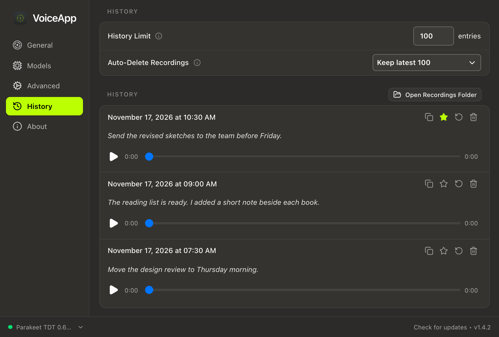

<div align="center">


# VoiceApp

**Free, open-source dictation for Mac.**<br />
Hold a shortcut, speak, and release to type your words into the app you’re using.

<p>
  <a href="https://github.com/DistinctZA/voice-app/releases/latest"></a>
  <a href="LICENSE"></a>
  
  
</p>

<p>
  <a href="#build-from-source"><b>Build for Mac</b></a> ·
  <a href="#update-your-build">Update your build</a> ·
  <a href="https://voice-app.xyz/">Website</a> ·
  <a href="#features">Features</a>
</p>


</div>

VoiceApp lives in the menu bar. With a local model, dictation works offline and your audio stays on your Mac. You can also choose a cloud provider and use your own API key.

## Build from source

On an Apple silicon Mac, install Xcode Command Line Tools (`xcode-select --install`), [Rust](https://rustup.rs/), [Bun](https://bun.sh/), and CMake (`brew install cmake`). Run these commands in Terminal.

```bash
git clone https://github.com/DistinctZA/voice-app.git
cd voice-app
./scripts/install.sh
```

The installer compiles VoiceApp on your Mac, installs it in **Applications**, and remembers this checkout for future updates. A local build uses an ad-hoc signature generated on your Mac. It works without a GitHub login or an Apple Developer account.

For a standalone bundle you can install yourself, run `bun run build:mac` in the checkout. The app is written to `src-tauri/target/local/release/bundle/macos/VoiceApp.app`. For live development with the **VoiceApp v1.4.2 (Dev)** menu bar label, see the [development notes](docs/development.md).

## Update your build

Open Terminal in the same `voice-app` folder and run the installer again.

```bash
./scripts/install.sh
```

It checks GitHub, asks before pulling new commits, and rebuilds and replaces the installed app when an update is available. Your settings, downloaded models, and dictation history stay in your macOS user data folder.

If you installed the standalone bundle manually, rebuild it from the same checkout.

```bash
git pull --ff-only
bun run build:mac
```

Quit VoiceApp, replace your copy in **Applications** with the rebuilt `VoiceApp.app`, and reopen it.

## First dictation

1. Grant **Microphone** access to record and **Accessibility** access to type into other apps.
2. Choose a model. Try **Parakeet TDT 0.6B v2** for English or **Whisper** for multilingual dictation.
3. Place your cursor in a text field, hold **Option + Space**, speak, and release. You can change the shortcut in **General**.

## Features

- **Dictate into other apps.** Hold the shortcut to talk, or switch to toggle mode to start and stop with a tap.
- **Transcribe on your Mac.** Download Parakeet or Whisper once and switch between installed models in General.
- **Use a cloud model.** Connect OpenAI, Grok, ElevenLabs, or OpenRouter in Models. Your provider’s usage charges apply.
- **Choose how text is delivered.** Paste at the cursor, type directly, or copy the transcript to the clipboard.
- **Revisit a recording.** History lets you play the audio, copy a transcript, save a favourite, or retry a transcription.

<div align="center">

<br />
<sub>Sample dictations in History. The highlighted star marks a saved favourite.</sub>
</div>

## Previous Mac downloads

Previously published signed disk images are available in the [Mac release archive](https://github.com/DistinctZA/voiceapp-releases/releases).

## License

[MIT](LICENSE). VoiceApp is maintained by [DistinctZA](https://github.com/DistinctZA) and is derived from [Handy](https://github.com/cjpais/Handy) by [CJ Pais](https://github.com/cjpais). [Report a bug or suggest a feature](https://github.com/DistinctZA/voice-app/issues).
